# VideoSense AI — Phase 3 Technical Design & Implementation Report
## Multimodal Retrieval & Semantic Search System

---

## 1. Project Objectives
The primary objective of the **VideoSense AI** platform is to build an intelligent, enterprise-grade multimodal video understanding system. By leveraging advanced computer vision, deep speech recognition, and optical character recognition (OCR), the system parses and structures unstructured video streams. 

Phase 3 is designed to transform these structured metadata checkpoints into searchable, semantic index vector spaces, enabling instant natural language queries across video frames, spoken dialogue, on-screen text overlays, and high-level file metadata.

---

## 2. Scope of Phase 3
Phase 3 establishes the foundation for semantic search and retrieval orchestration. The scope is defined as follows:

*   **In Scope**:
    *   Dynamic generation of textual and visual feature vectors (embeddings).
    *   Persistent local serialization of high-dimensional vectors on disk.
    *   Relational database tracking of embedding profiles and model versions.
    *   Vectorized cosine similarity comparison algorithms.
    *   Heuristic natural language query intent parsing and routing.
    *   Search REST API exposure with strict schema validation.
*   **Out of Scope (Deferred to Phase 4)**:
    *   Generative LLM query responding (RAG answer synthesis).
    *   Conversational history tracking and chat memory state buffers.
    *   Persistent agent conversation database models (`AgentMemory`).

---

## 3. Technology Stack
The architectural capabilities added in Phase 3 are powered by the following enterprise technology stack:

| Component | Technology | Version / Specific Model | Role / Description |
| :--- | :--- | :--- | :--- |
| **Core Language** | Python | `3.11.x` | Backend runtime environment |
| **Web Framework** | FastAPI | `0.110.x` | High-performance ASGI REST API framework |
| **Vector Mathematics** | NumPy | `1.26.x` | High-performance array operations & vectorized cosine calculations |
| **Deep Learning** | PyTorch | `2.2.x` | Execution backend for visual and text transformers |
| **Text Embedding** | SentenceTransformers | `all-MiniLM-L6-v2` (384d) | Vectorizing transcript, OCR, and metadata strings |
| **Visual Embedding** | SentenceTransformers / CLIP | `openai/clip-vit-base-patch32` (512d) | High-dimensional keyframe visual features extraction |
| **Database ORM** | SQLAlchemy / Alembic | `2.0.x` / `1.13.x` | Relational schema definition & PostgreSQL migrations |
| **Image Processing** | Pillow (PIL) | `10.2.x` | Visual format transforms and RGBA to RGB safety filters |
| **Testing Suite** | pytest | `9.1.x` | Automated unit and integration testing runner |

---

## 4. Architectural Design
Phase 3 integrates asynchronous ingestion and vectorization pipelines with a low-latency synchronous semantic query routing layer.

### Architectural Component Flow

```mermaid
flowchart TD
    %% Ingestion Flow
    subgraph Ingestion Pipeline [Asynchronous Ingestion & Vectorization]
        A[Upload API / Main Ingestion] --> B[Sequential AI Stages: Transcription, OCR, Scene & Object Detection]
        B --> C[Stage 9: Main Pipeline Completes]
        C --> D[Queue Async Embedding Task]
        D --> E[EmbeddingWorker Thread Runs]
        E --> F[Fetch AI Text and Frame Tables]
        F --> G[EmbeddingService: MiniLM & CLIP]
        G --> H[(VectorStorageService: Local .npy Files)]
        G --> I[(Postgres: VideoEmbedding Records)]
    end

    %% Query Flow
    subgraph Semantic Search [Retrieval & Cosine Search]
        J[Client Request] --> K[POST /api/v1/search]
        K --> L[AgentOrchestrator: Parse Query Keywords Heuristically]
        L --> M[Resolve Modality: TEXT, FRAME, AUDIO, or METADATA]
        M --> N[SearchService: Convert Query String to Vector]
        N --> O[Load stored .npy vectors via BytesIO]
        O --> P[Vectorised Cosine Similarity Rankings]
        P --> Q[Resolve Matched Content & Keyframe Timestamps]
        Q --> R[Return Sorted ResponseEnvelope]
    end
```


---

## 5. Storage Directory Structure
All generated vector binaries and metadata map indexes are structured hierarchically under the project's base storage path. The filesystem layout is organized as follows:

```text
backend/storage/embeddings/
  └── {video_id}/
      ├── text.npy              # 384-dimensional vector representing OCR text overlays
      ├── audio.npy             # 384-dimensional vector representing Whisper speech dialogues
      ├── metadata.npy          # 384-dimensional vector representing technical file metadata
      ├── frame.npy             # Stacked [N, 512] visual feature vectors representing keyframes
      └── frame_metadata.json   # Mappings tracking frame index, timestamp, and visual file references
```

*   **`frame.npy`**: Stored as a single 2D NumPy array of shape `(num_keyframes, 512)`.
*   **`frame_metadata.json`**: An ordered JSON array mapping each keyframe index to its temporal offset in the video and its filesystem source location:
    ```json
    [
      {
        "frame_index": 0,
        "timestamp": 1.5,
        "path": "storage/previews/test_video/frame_0.jpg"
      }
    ]
    ```

---

## 6. Complete Ingestion Pipeline Stage Overview
With the integration of Phase 3, the video processing pipeline executes sequentially through the following progress checkpoints:

```text
[Stage 1: Metadata] ──► [Stage 2: Frame Extr.] ──► [Stage 3: Audio Extr.] ──► [Stage 4: Scene Det.]
       │
       ▼
[Stage 5: OCR] ───────► [Stage 6: Speech/Whisper] ──► [Stage 7: Obj. Det.] ──► [Stage 8: Face Det.]
       │
       ▼
[Stage 9: Embedding Generation] ──► [Stage 10: Complete]
```

| Pipeline Stage | Core Action | Progress Mapping |
| :--- | :--- | :---: |
| **`metadata`** | Extract technical container info, resolution, codec configurations | `10%` |
| **`frame_extraction`** | Extract visual frame sequences and keyframe checkpoints | `25%` |
| **`audio_extraction`** | Strip container audio stream to separate `.wav` buffers | `40%` |
| **`scene_detection`** | Detect structural scene changes and temporal video cuts | `55%` |
| **`ocr`** | Read on-screen visual overlays using EasyOCR engines | `70%` |
| **`speech`** | Perform deep transcription using Whisper speech models | `82%` |
| **`object_detection`** | Classify bounding box elements via YOLO object models | `94%` |
| **`face_detection`** | Map facial identification coordinates and profiles | `96%` |
| **`embedding_generation`** | Generate multimodal vector representations & write `.npy` arrays | `98%` |
| **`completed`** | Pipeline execution success checkpoint | `100%` |

---

## 7. High-Level Component Interaction Summary
When a client issues a semantic search query, components interact synchronously to resolve similarity rankings:

```
┌────────┐          ┌──────────────────┐          ┌───────────────┐          ┌─────────────────────┐
│ Client │          │ AgentOrchestrator│          │ SearchService │          │ VectorStorageService│
└────┬───┘          └────────┬─────────┘          └───────┬───────┘          └──────────┬──────────┘
     │   POST /search        │                            │                             │
     ├──────────────────────>│                            │                             │
     │                       │  analyze_query(text)       │                             │
     │                       ├──────────────────┐         │                             │
     │                       │                  │         │                             │
     │                       │<─────────────────┘         │                             │
     │                       │                            │                             │
     │                       │  search(query, modality)   │                             │
     │                       ├───────────────────────────>│                             │
     │                       │                            │  load_vector()              │
     │                       │                            ├────────────────────────────>│
     │                       │                            │  (Reads .npy into memory)   │
     │                       │                            │<────────────────────────────┤
     │                       │                            │                             │
     │                       │                            │  Compute Cosine Similarity  │
     │                       │                            ├──────────────────┐          │
     │                       │                            │                  │          │
     │                       │                            │<─────────────────┘          │
     │                       │                            │                             │
     │                       │  Ranked Results            │                             │
     │                       │<───────────────────────────┤                             │
     │  ResponseEnvelope     │                            │                             │
     │<──────────────────────┤                            │                             │
```

---

## 8. Database Architecture Extensions

### A. Video Embedding Models (`backend/app/models/embedding.py`)
Extended the relational database structure to support tracking embedding model versions for backward compatibility and index matching:
*   Added `embedding_model_version` (String, nullable) property inside the `VideoEmbedding` model.
*   Constructed bidirectional ORM relationships mapping:
    *   `Video` has many `embeddings` relationships.
    *   `VideoEmbedding` links back to `video` reference.

### B. Database Migrations
Created and executed the Alembic migration script:
*   **Filename**: `backend/alembic/versions/a96ec4ed79c4_add_embedding_model_version.py`
*   **Action**: Added the `embedding_model_version` column to the `video_embeddings` table and verified schema updates in the local PostgreSQL instance.

---

## 9. Configuration & Profile Customizations

Integrated active configurations for loading embedding engines under Settings profiles:
*   **Settings Object (`backend/app/core/config.py`)**:
    *   Defined the `EmbeddingSettings` Pydantic class containing properties for `storage_path`, `text_model_name`, and `vision_model_name`.
    *   Mounted settings as `settings.embeddings`.
*   **YAML Config Profiles (`configs/development.yaml` & `configs/production.yaml`)**:
    *   Added standard defaults:
        ```yaml
        embeddings:
          storage_path: "storage/embeddings"
          text_model_name: "sentence-transformers/all-MiniLM-L6-v2"
          vision_model_name: "openai/clip-vit-base-patch32"
        ```

---

## 10. Lazy-Loaded Multimodal Embedding Service

Implemented the abstract interfaces and service classes under:
*   `backend/app/interfaces/embedding.py`
*   `backend/app/infrastructure/providers/embedding_service.py`

### Key Features:
*   **Lazy-loading**: Models are loaded on-demand using caching helpers (`_get_text_model()` and `_get_vision_model()`) to conserve RAM/VRAM during application startup.
*   **Modalities Supported**:
    1.  `TEXT` (Dimension: 384): Uses `sentence-transformers/all-MiniLM-L6-v2` for OCR visual text features.
    2.  `AUDIO` (Dimension: 384): Uses `sentence-transformers/all-MiniLM-L6-v2` to vectorize Whisper transcription logs.
    3.  `VIDEO_METADATA` (Dimension: 384): Vectorizes technical descriptors (codec, FPS, width, height, resolution).
    4.  `FRAME` (Dimension: 512): Uses `openai/clip-vit-base-patch32` to encode keyframe images.
*   **Transparency Processing Safety**: Converts frame images (such as `RGBA` or `P` palettes) to `RGB` mode before calling the CLIP model to prevent indexing crashes.
*   **Query Embedding Resolution**: Exposes `generate_query_embedding(query, modality)` to vectorize input queries according to the selected search target.

---

## 11. Local Vector Storage Service

Persistent vector management is handled by:
*   `backend/app/interfaces/vector_storage.py`
*   `backend/app/infrastructure/storage/vector_storage.py`

### Key Features:
*   **Disk Path Layout**: Saves numpy array indices under `storage/embeddings/{video_id}/` as:
    *   `text.npy`
    *   `audio.npy`
    *   `metadata.npy`
    *   `frame.npy` (Contains the stacked visual vectors of shape `[num_keyframes, 512]`)
*   **Temporal Keyframe Index Map**: Saves a companion `frame_metadata.json` map containing index offsets, timestamps, and image filenames.
*   **Windows-Safe Memory Buffers**: When loading files, it reads binaries completely into an in-memory `io.BytesIO` stream. This prevents file locking issues on Windows and allows background deletion calls to execute cleanly.
*   **Retry Mechanisms**: Features retry loops in `delete_vector` to resolve file contentions (such as antivirus scans or file system watches).

---

## 12. Asynchronous Background Embedding Worker

Designed and implemented:
*   `backend/app/workers/embedding_worker.py`

### Key Features:
*   **Isolated Thread Runs**: Dispatches embedding execution to background threads using a custom `Threading` worker wrapper so main video ingestion routes remain responsive.
*   **Pipeline Status Mappings**: Uses `EMBEDDING_PENDING`, `EMBEDDING_PROCESSING`, `completed`, and `failed` status flags inside the PostgreSQL `Job` schema to track processing progress.
*   **Data Serialization Flow**:
    1.  Loads all database records for the targeted `video_id` (Whisper segments, OCR entries, scene detections, video dimensions).
    2.  Assembles text summaries and vectorizes them using the embedding service.
    3.  Iterates through extracted keyframe JPG files, computes CLIP visual tensors, and writes arrays/metadata maps to disk.
    4.  Saves corresponding `VideoEmbedding` index logs in the database.

---

## 13. Main Processing Pipeline Integration

Integrates Phase 3 into the core execution pipeline:
*   **`backend/app/processing/pipeline.py`**:
    *   Replaced the mock Stage 9 placeholder blocks with the `EmbeddingWorker.start_embedding_task()` trigger.
    *   Dispatches background processing once the main OCR/Object analysis finishes.
*   **`backend/app/processing/progress_tracker.py`**:
    *   Exposed `PipelineStage.EMBEDDING_GENERATION` mapping at `98%` progress.
*   **`backend/app/processing/checkpoints.py`**:
    *   Included the embedding generation stage in the pipeline checkpoint sequence.

---

## 14. Repository Extensions

Added CRUD operations to interface definitions and repository classes:
*   `backend/app/interfaces/repositories.py`
*   `backend/app/repositories/embedding_repository.py`

Exposed repository operations:
*   `create_embedding()`: Inserts a new `VideoEmbedding` DB row.
*   `get_by_video_id()`: Lists all vector indexes associated with a specific video.
*   `get_by_video_and_type()`: Resolves a vector mapping by video and target modality.
*   `delete_by_video_id()`: Removes DB mapping references.

---

## 15. Semantic Similarity Search Service

Developed the core vector comparison engine:
*   `backend/app/services/search_service.py`

### Key Features:
*   **Vectorised Cosine Calculations**:
    *   Uses NumPy vectorization to perform cosine calculations:
        $$\text{Similarity}(A, B) = \frac{A \cdot B}{\|A\| \|B\|}$$
*   **Frame Rank Matching**:
    *   Computes cosine metrics between the CLIP query vector and the `[N, 512]` array.
    *   Finds the index of the highest similarity score and resolves the timestamp offset via `frame_metadata.json`.
*   **Dialogue & Text Matching**:
    *   If searching transcripts or OCR, it performs keyword matching across segment data to retrieve the matching text snippet and its corresponding video timestamp.

---

## 16. Intelligent Query Classifier Agent

Created the retrieval controller:
*   `backend/app/ai_agents/agent_orchestrator.py`
*   `backend/app/ai_agents/__init__.py`

### Key Features:
*   **Natural Language Classification**:
    *   Heuristically parses user queries to identify intent and routes requests to the correct modality:
        *   Keywords like *"subtitles", "saying", "speak", "talking", "sound"* route to `AUDIO`.
        *   Keywords like *"ocr", "writing", "letters", "screen"* route to `TEXT`.
        *   Keywords like *"width", "fps", "codec", "resolution"* route to `METADATA`.
        *   Defaults to `FRAME` for general visual descriptions.
*   **Context Retrieval coordination**: Coordinates calls with `SearchService` and returns ranked matching data packages.

---

## 17. Search Router Endpoint

Developed the entry-point REST router:
*   `backend/app/api/v1/endpoints/search.py`
*   **Router Register (`backend/app/api/v1/router.py`)**: Mounted the search router under `/search` tag paths.

Exposes:
*   `POST /api/v1/search`:
    *   Validates input bodies using the `SearchRequest` schema model.
    *   Outputs results wrapped in the platform's standard `ResponseEnvelope`.

---

## 18. Validation & Quality Checks

Developed unit and integration test suites:
*   `backend/tests/unit/test_embedding_service.py`: Asserts correct vector shapes (MiniLM=384, CLIP=512) and image safety pre-processors.
*   `backend/tests/unit/test_vector_storage.py`: Validates local disk read/write/delete files with memory buffers.
*   `backend/tests/unit/test_search_service.py`: Simulates vector comparisons and verifies cosine sorting.
*   `backend/tests/unit/test_search_endpoint.py`: Tests API parameter checks and response envelopes.

All tests passed successfully:
```text
tests\unit\test_embedding_service.py .                                   [ 12%]
tests\unit\test_ingestion.py ...                                         [ 50%]
tests\unit\test_processing.py .                                          [ 62%]
tests\unit\test_search_endpoint.py .                                     [ 75%]
tests\unit\test_search_service.py .                                      [ 87%]
tests\unit\test_vector_storage.py .                                      [100%]

======================= 8 passed, 6 warnings in 41.77s ========================
```

---

## 19. Design Decisions & Rationale
Several technical design decisions were made in Phase 3 to balance performance, simplicity, and platform robustness:

1.  **Local File System Vector Storage (`.npy`)**:
    *   *Decision*: Store high-dimensional visual and textual vectors as `.npy` array files locally rather than adopting heavy vector databases (e.g. Pinecone, Milvus, ChromaDB) in Phase 3.
    *   *Rationale*: Avoids complex external dependencies and network latencies while providing fast NumPy calculations. The architecture remains modular so that vector storage layers can easily be replaced by dedicated database plugins.
2.  **Lazy Model Loading**:
    *   *Decision*: Instantiate deep learning models (MiniLM + CLIP) on demand during the first worker execution loop rather than statically loading them at container initialization.
    *   *Rationale*: Reduces initial system memory usage and prevents slow application startup and routing timeouts in local execution contexts.
3.  **In-Memory BytesIO Operations on Windows**:
    *   *Decision*: Read vector binaries into an in-memory `io.BytesIO` stream instead of loading file paths directly inside `np.load`.
    *   *Rationale*: Excludes physical filesystem locks immediately after read execution, resolving Windows NTFS file access sharing contentions (`WinError 5 PermissionError`) during rapid write-delete cycles in automated tests.

---

## 20. Performance Considerations
*   **Vectorization Memory Management**: Image vectors are generated keyframe-by-keyframe using a batch loading iterator. This keeps deep learning memory structures isolated and prevents CUDA or CPU RAM exhaustion.
*   **Vectorised Array Comparisons**: Consolidating visual frame vectors into a single stacked `(N, 512)` matrix permits high-speed parallel comparisons via vectorized matrix multiplications in NumPy, yielding search times under 10ms for standard catalog sizes.
*   **Non-Blocking Operations**: Heavy vector calculations and filesystem disk writes run asynchronously in the background. The core ingestion worker is freed up to return 200 HTTP status packets to the user immediately upon video ingest.

---

## 21. Error Handling Strategy
*   **Robust Deletion Retry Loops**: Deletion calls to the storage engine feature 5-attempt retry loops with brief sleeps. This resolves file locks from operating system indexers or antivirus scans.
*   **Unit of Work Consistency**: Vector indexing records in PostgreSQL are committed inside SQLAlchemy `UnitOfWork` blocks. In the event of a validation or filesystem write failure, database entries are rolled back to maintain consistency.
*   **Graceful Modality Fallbacks**: If the orchestrator selects a modality that does not contain generated embeddings (e.g., a video has no audio track, so `audio.npy` is missing), the search engine gracefully falls back to visual frame search (`FRAME`) instead of throwing an API error.

---

## 22. Limitations of Phase 3
*   **Scalability Thresholds**: Local `.npy` comparisons are optimal for small to medium catalogs (thousands of videos) but will face memory/CPU constraints at millions of files.
*   **Dynamic Thread Constraints**: The background tasks run in local Python daemon threads. This is suitable for single-node deployments but lacks the distributed scaling capabilities of job queues (e.g., Celery, Redis, or RabbitMQ).
*   **Zero Conversational Memory**: The query routing layer is retrieval-only. It cannot parse questions that reference previous queries (e.g., "Find the red car. Now show it turning left.") as it lacks state mapping.

---

## 23. Future Work (Phase 4 Preview)
Phase 4 will build on the retrieval foundation implemented in Phase 3 by adding generative reasoning and conversation states:
*   **Generative RAG Synthesizers**: Integrate LLM models to read semantic matches and write narrative text answers explaining query results.
*   **Conversation Buffers**: Develop state managers to track user interaction history.
*   **Distributed Job Queues**: Migrate from daemon threads to Celery and Redis to scale indexing workers horizontally.

---

## 24. Conclusion
Phase 3 establishes a robust, highly performant, and clean multimodal retrieval foundation. By successfully vectorizing transcription log details, OCR textual elements, keyframe structures, and container metadata, the VideoSense AI backend now delivers robust natural language search results. All unit and integration verification tasks confirm that the system runs reliably.
