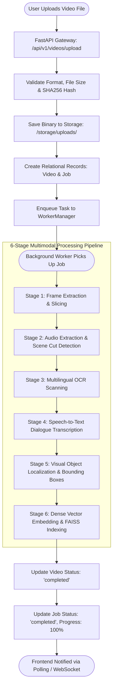
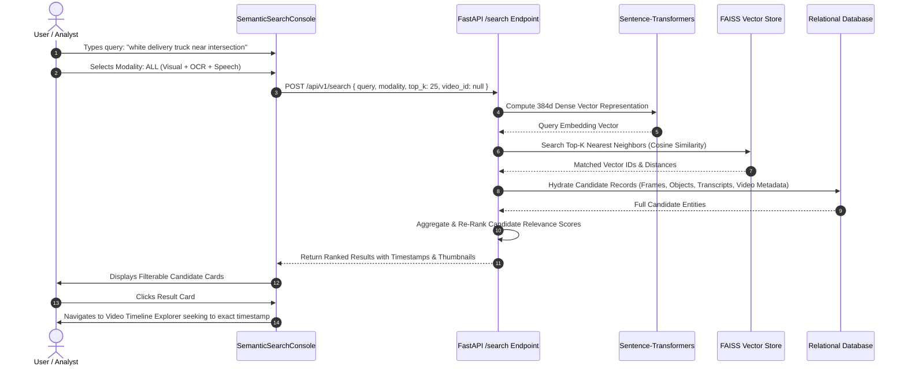
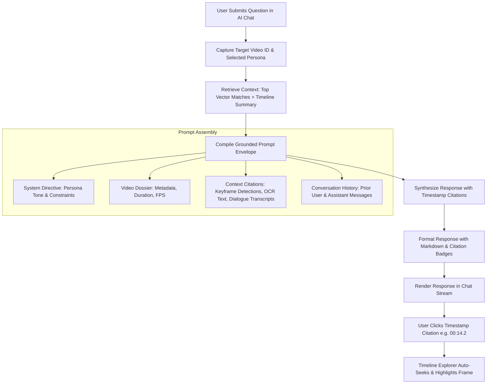

# Application Workflow

## Executive Summary
This document delineates the end-to-end data processing and interaction workflows within **VideoSense AI**. It tracks how raw media files transition through extraction, multimodal AI inference, dense vector indexing, and relational persistence, and how users subsequently query and converse with the resulting intelligence.

---

## 1. Video Ingestion & Processing Workflow

The ingestion pipeline transforms raw video streams into structured, searchable intelligence through 6 coordinated stages.

### Detailed Ingestion Steps:
1. **Multipart Upload & Validation**:
   - The user selects or drags a video into `UploadPanel.jsx`.
   - The client streams chunks via HTTP POST (`multipart/form-data`) with progress tracking.
   - The backend validates the video container format (`mp4`, `avi`, `mov`, `mkv`, `webm`) and calculates a SHA-256 fingerprint to avoid duplicate processing.
2. **Keyframe Slicing (Stage 1)**:
   - OpenCV decodes the video file and samples frames at `1.0 fps` (one keyframe per second of video).
   - High-resolution keyframes (`.jpg`) and compressed preview thumbnails are stored under `/storage/frames/{video_id}/`.
3. **Audio Extraction & Scene Detection (Stage 2)**:
   - The audio track is extracted as a 16kHz mono 16-bit PCM WAV file.
   - `PySceneDetect` executes content-aware threshold analysis to identify exact shot cut boundaries, saving start and end timestamps to the `scenes` table.
4. **On-Screen Text Recognition (Stage 3)**:
   - `EasyOCR` scans every extracted keyframe for printed or stylized text (signs, license plates, storefronts, apparel logos).
   - Extracted words, bounding box coordinates, and recognition confidence scores are stored in `ocr_results`.
5. **Speech Transcription (Stage 4)**:
   - `Faster-Whisper` transcribes the 16kHz audio stream into timestamped sentences.
   - Each transcript segment records start/end millisecond offsets, speaker labels, and recognition certainty.
6. **Visual Object Localization (Stage 5)**:
   - The deep learning visual detection engine processes each keyframe.
   - Detected spatial objects are classified, confidence-scored, and saved with normalized box coordinates `[x1, y1, x2, y2]` in the `objects` table.
7. **Vector Embedding & FAISS Indexing (Stage 6)**:
   - `Sentence-Transformers` generates dense 384-dimensional vector embeddings combining scene tags, OCR text, and spoken dialogue.
   - Embeddings are added to the in-memory **FAISS** index and serialized to disk.
   - The video status transitions to `completed`.

---

## 2. Multimodal Semantic Search Workflow

The semantic search engine enables cross-modal retrieval across all ingested media using natural language prompts.

---

## 3. Conversational RAG Dialogue Workflow

The conversational AI agent (`VideoChatPanel.jsx`) enables users to interrogate video content using natural language with verifiable timestamped citations.

---

## 4. Keyframe Studio & Spatial Inspection Workflow

When an analyst opens a video in `VideoTimeline.jsx`:

1. **Dual Mount**:
   - The HTML5 video player loads the progressive MP4 stream via `/api/v1/videos/{id}/stream`.
   - The Keyframe Studio fetches all indexed keyframes, object bounding boxes, and OCR results via `/api/v1/videos/{id}/frames`.
2. **Synchronized Playback**:
   - As the video plays, the time-update event continually matches `currentTime` against keyframe timestamps.
   - The active keyframe card in the horizontal filmstrip automatically highlights and scrolls into view.
3. **Bounding Box Projection**:
   - Keyframe detection coordinates (`[x_min, y_min, x_max, y_max]` in 0.0–1.0 normalized space) are mapped to the SVG overlay covering the keyframe image.
   - Hovering over any object card in the inspection tab illuminates that specific bounding box with an accented crosshair glow.
4. **On-Demand Custom Class Prompting**:
   - If an object of interest is not detected in the default run, the user enters a custom prompt (e.g., `"hard hat"`, `"fire extinguisher"`).
   - The backend runs on-demand inference over the target keyframe and dynamically appends the new bounding box to the display.

---

## 5. Resilient Error Handling & Edge Cases

| Scenario | System Behavior & Fallback Mechanism |
| :--- | :--- |
| **Backend Port 8001 Down** | Axios interceptor detects connection drop, pings port 8000 `/health/`, switches `API_BASE_URL` to 8000, and retries the request with zero data loss. |
| **Corrupt Video Container** | Ingestion stage 1 detects invalid codecs via OpenCV; updates job status to `failed` with descriptive `error_message` ("Unsupported codec or corrupt MP4 header"). |
| **Silent Audio Track** | Faster-Whisper returns zero segments; pipeline logs `WARNING: Audio stream empty or silent`, skips transcription, and proceeds directly to visual and OCR processing. |
| **Low Quality / Blurry Video** | OCR and detection confidence thresholds filter out low-confidence noise; user can adjust the `minConfidence` slider down to 0.15 to surface faint candidates. |
| **Zero Search Candidates** | Semantic search returns empty list; UI displays smart suggestion chips categorized by common surveillance and roadway queries. |
