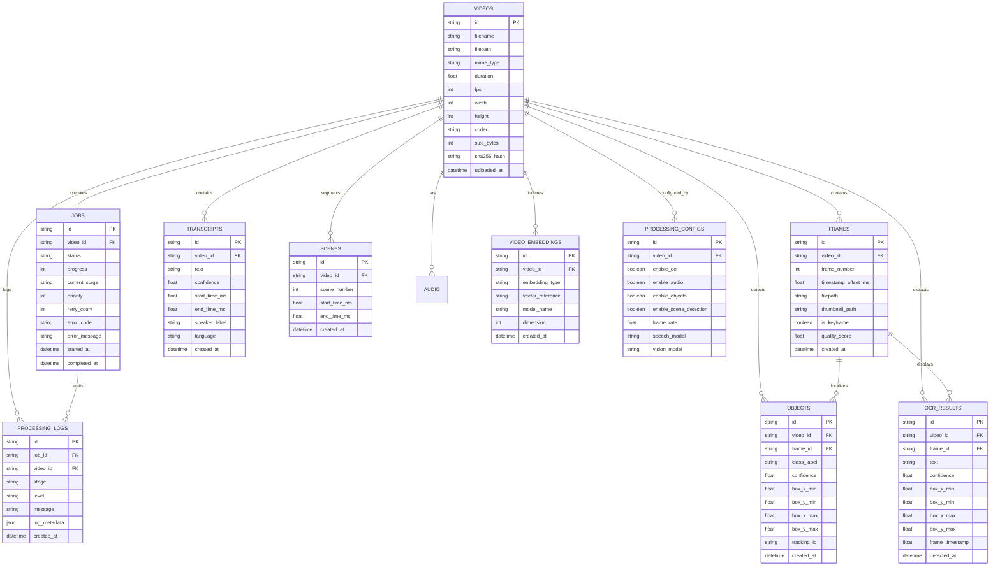

# Database Documentation

## Executive Summary
**VideoSense AI** leverages a dual-engine persistence architecture designed for both structured transactional consistency and high-speed similarity retrieval.
1. **Relational Database (SQLAlchemy ORM + SQLite/PostgreSQL)**: Stores video metadata, job queues, frame references, timestamps, bounding box coordinates, spoken transcripts, and audit logs.
2. **Dense Vector Store (FAISS)**: Stores 384-dimensional dense semantic embeddings for cross-modal similarity search.

---

## 1. Entity-Relationship (ER) Diagram



---

## 2. Relational Table Specifications

### 2.1 `videos` Table
Stores uploaded video asset descriptors and technical media attributes.

| Column | Data Type | Constraints | Description |
| :--- | :--- | :--- | :--- |
| `id` | `VARCHAR` | Primary Key, Indexed | Unique UUID identifier for the video asset. |
| `filename` | `VARCHAR` | Not Null, Indexed | Original file name at time of upload. |
| `filepath` | `VARCHAR` | Not Null | Local disk storage path (`/storage/uploads/...`). |
| `mime_type`| `VARCHAR` | Not Null | Video MIME format (e.g., `video/mp4`). |
| `duration` | `FLOAT` | Nullable | Total video runtime in seconds. |
| `fps` | `INTEGER` | Nullable | Video frame rate (frames per second). |
| `width` | `INTEGER` | Nullable | Horizontal video resolution in pixels. |
| `height` | `INTEGER` | Nullable | Vertical video resolution in pixels. |
| `codec` | `VARCHAR` | Nullable | Video encoding codec (e.g., `h264`, `avc1`, `hevc`). |
| `size_bytes`| `INTEGER` | Not Null | Total file payload size in bytes. |
| `sha256_hash`| `VARCHAR` | Not Null | SHA-256 binary hash for integrity and deduplication. |
| `uploaded_at`| `DATETIME`| Not Null, Indexed | UTC timestamp of initial upload. |

---

### 2.2 `jobs` Table
Tracks asynchronous background processing pipelines and state transitions.

| Column | Data Type | Constraints | Description |
| :--- | :--- | :--- | :--- |
| `id` | `VARCHAR` | Primary Key, Indexed | Unique UUID for the execution job. |
| `video_id` | `VARCHAR` | Foreign Key (`videos.id`), Not Null | Associated video record. |
| `status` | `VARCHAR` | Not Null, Default: `"queued"` | State: `queued`, `running`, `completed`, `failed`. |
| `progress` | `INTEGER` | Not Null, Default: `0` | Completion percentage (0–100). |
| `current_stage`| `VARCHAR` | Nullable | Active stage: `metadata`, `frames`, `ocr`, `speech`, `objects`, `embeddings`. |
| `priority` | `INTEGER` | Not Null, Default: `0` | Queue priority (higher numbers executed first). |
| `retry_count` | `INTEGER` | Not Null, Default: `0` | Count of retry attempts. |
| `error_code` | `VARCHAR` | Nullable | Machine-readable error code if failed. |
| `error_message` | `VARCHAR` | Nullable | Detailed human-readable error description. |
| `started_at` | `DATETIME` | Nullable | Timestamp when background worker started execution. |
| `completed_at` | `DATETIME` | Nullable | Timestamp of completion or terminal failure. |

---

### 2.3 `frames` Table
Contains keyframes extracted from videos at regular intervals (default: 1.0 fps).

| Column | Data Type | Constraints | Description |
| :--- | :--- | :--- | :--- |
| `id` | `VARCHAR` | Primary Key, Indexed | Keyframe unique UUID. |
| `video_id` | `VARCHAR` | Foreign Key (`videos.id`), Not Null | Parent video. |
| `frame_number` | `INTEGER` | Not Null | Sequential index of the frame. |
| `timestamp_offset_ms`| `FLOAT` | Not Null | Millisecond position of the frame in the video stream. |
| `filepath` | `VARCHAR` | Not Null | File system path to the full-resolution keyframe JPEG. |
| `thumbnail_path` | `VARCHAR` | Nullable | Path to the compressed preview thumbnail. |
| `is_keyframe` | `BOOLEAN` | Not Null, Default: `False` | True if identified as a high-salience keyframe. |
| `quality_score` | `FLOAT` | Nullable | Contrast and sharpness metric score (0.0–1.0). |
| `created_at` | `DATETIME` | Not Null | Timestamp of extraction. |

---

### 2.4 `objects` Table
Stores spatial bounding boxes and classifications detected by the visual analysis engine.

| Column | Data Type | Constraints | Description |
| :--- | :--- | :--- | :--- |
| `id` | `VARCHAR` | Primary Key, Indexed | Object detection UUID. |
| `video_id` | `VARCHAR` | Foreign Key (`videos.id`), Not Null | Parent video. |
| `frame_id` | `VARCHAR` | Foreign Key (`frames.id`), Nullable | Specific keyframe where target was detected. |
| `class_label` | `VARCHAR` | Not Null, Indexed | Detected entity classification (e.g., `car`, `person`, `traffic cone`). |
| `confidence` | `FLOAT` | Not Null | Model certainty probability score (0.0 to 1.0). |
| `box_x_min` | `FLOAT` | Not Null | Normalized left edge coordinate (0.0–1.0). |
| `box_y_min` | `FLOAT` | Not Null | Normalized top edge coordinate (0.0–1.0). |
| `box_x_max` | `FLOAT` | Not Null | Normalized right edge coordinate (0.0–1.0). |
| `box_y_max` | `FLOAT` | Not Null | Normalized bottom edge coordinate (0.0–1.0). |
| `tracking_id` | `VARCHAR` | Nullable | Temporal tracking identifier across frames. |

---

### 2.5 `transcripts` Table
Stores spoken dialogue extracted by the speech recognition engine.

| Column | Data Type | Constraints | Description |
| :--- | :--- | :--- | :--- |
| `id` | `VARCHAR` | Primary Key, Indexed | Transcript segment UUID. |
| `video_id` | `VARCHAR` | Foreign Key (`videos.id`), Not Null | Parent video. |
| `text` | `VARCHAR` | Not Null, Indexed | Spoken dialogue sentence. |
| `confidence` | `FLOAT` | Not Null | Acoustic model decoding certainty (0.0–1.0). |
| `start_time_ms`| `FLOAT` | Not Null | Timestamp offset where the utterance began. |
| `end_time_ms` | `FLOAT` | Not Null | Timestamp offset where the utterance ended. |
| `speaker_label`| `VARCHAR` | Nullable | Diarized speaker identity (e.g., `SPEAKER_01`). |
| `language` | `VARCHAR` | Nullable | Detected spoken ISO language code (e.g., `en`). |

---

### 2.6 `ocr_results` Table
Contains printed and stylized on-screen text recognized across video keyframes.

| Column | Data Type | Constraints | Description |
| :--- | :--- | :--- | :--- |
| `id` | `VARCHAR` | Primary Key, Indexed | OCR detection UUID. |
| `video_id` | `VARCHAR` | Foreign Key (`videos.id`), Not Null | Parent video. |
| `frame_id` | `VARCHAR` | Foreign Key (`frames.id`), Nullable | Keyframe where text was detected. |
| `text` | `VARCHAR` | Not Null, Indexed | Recognized alphanumeric string. |
| `confidence` | `FLOAT` | Not Null | Character recognition certainty (0.0–1.0). |
| `box_x_min` | `FLOAT` | Not Null | Normalized bounding box coordinates. |
| `box_y_min` | `FLOAT` | Not Null | Normalized bounding box coordinates. |
| `box_x_max` | `FLOAT` | Not Null | Normalized bounding box coordinates. |
| `box_y_max` | `FLOAT` | Not Null | Normalized bounding box coordinates. |
| `frame_timestamp` | `FLOAT` | Nullable | Timestamp in seconds where the text appeared. |

---

## 3. Vector Database Architecture (FAISS)

VideoSense AI uses **FAISS (Facebook AI Similarity Search)** to index multimodal vector embeddings for fast nearest-neighbor retrieval.

```text
┌────────────────────────────────────────────────────────────────────────┐
│ FAISS VECTOR REPOSITORY SPECIFICATIONS                                 │
├────────────────────────────────┬───────────────────────────────────────┤
│ Index Architecture             │ FAISS IndexFlatIP (Inner Product)     │
│ Vector Dimensionality          │ 384 Dimensions (Dense Float32 Arrays) │
│ Distance Metric                │ Cosine Similarity (Normalized IP)     │
│ Query Latency Target           │ < 5.0 milliseconds for top-25 results │
│ Persistence Mechanism          │ Disk serialization (vector_store.idx) │
│ Metadata Association           │ Key-value map referencing UUID & time │
└────────────────────────────────┴───────────────────────────────────────┘
```

### Ingestion & Search Protocol:
1. **Vector Construction**: Text summaries, OCR labels, and visual captions are embedded into 384-dimensional `numpy.float32` arrays.
2. **L2 Normalization**: Vectors undergo Euclidean unit normalization (`v / ||v||`) ensuring Inner Product operations equate to Cosine Similarity.
3. **Index Insertion**: Vectors are appended to the index with sequential integer IDs mapped to video UUIDs and timestamps in `metadata.json`.
4. **Search Execution**: User queries are embedded on the fly and queried against the index using `index.search(query_vector, top_k)`.

---

## 4. Migrations & Versioning (Alembic)

Database schema revisions are managed using **Alembic**. Migration scripts reside under `backend/alembic/versions/` and guarantee reproducible database state across environments:
- `alembic upgrade head`: Applies all outstanding schema migrations.
- `alembic revision --autogenerate -m "description"`: Inspects declarative models and produces an automated migration script.
