# Frontend Component Breakdown

## Executive Summary
The **VideoSense AI** frontend is structured as a component-driven Single Page Application (SPA). Components are isolated, reusable, and strictly separated into domain categories:
- **Common Layout**: Persistent app chrome, ambient canvases, and navigation bars.
- **Core Workspace Modules**: Overview dashboard, upload manager, library grid, and multimodal video timeline.
- **AI Intelligence Consoles**: Semantic search engine, conversational RAG chat, and automated pipeline monitor.
- **Analytics & Governance**: System health telemetry, analytics hub, automated PDF reports, and model status.
- **Global Overlays**: Floating AI assistant and keyboard-driven command palette.

---

## 1. Global Component Hierarchy & Data Flow

```mermaid
graph TD
    App["App.jsx (Root State & Tab Router)"]
    
    %% Common Persistent Chrome
    App --> Blobs["BackgroundBlobs.jsx (7-Layer Canvas)"]
    App --> Navbar["Navbar.jsx (Sticky Header & Telemetry)"]
    App --> Sidebar["Sidebar.jsx (Collapsible Navigation Rail)"]
    App --> Copilot["FloatingAssistant.jsx (Floating AI Copilot)"]
    App --> Palette["CommandPalette.jsx (Ctrl+K Modal)"]

    %% Main Workspace Panels
    App --> Overview["Overview.jsx (Dashboard Summary)"]
    App --> Upload["UploadPanel.jsx (Ingestion Center)"]
    App --> Library["VideoLibrary.jsx (Asset Management)"]
    App --> Timeline["VideoTimeline.jsx (Spatial & Multimodal Studio)"]
    App --> Processing["AIProcessingConsole.jsx (6-Stage Pipeline)"]
    App --> Search["SemanticSearchConsole.jsx (Multimodal Search)"]
    App --> Chat["VideoChatPanel.jsx (Conversational Video Agent)"]
    App --> Products["Product Discovery (Visual Match Grid)"]
    App --> Analytics["AnalyticsDashboard.jsx (Telemetry & Recharts)"]
    App --> Reports["ReportsManager.jsx (Audit Dossier Generator)"]
    App --> Models["AIModels.jsx (Engine Registry)"]
    App --> Monitor["SystemMonitor.jsx (Hardware Telemetry)"]
    App --> Logs["ActivityLogs.jsx (Execution Traces)"]
    App --> Profile["ProfilePanel.jsx (User Settings)"]
    App --> Settings["SettingsPanel.jsx (Platform Configuration)"]
```

---

## 2. Core Layout & Common Components

### 2.1 `App.jsx`
- **Location**: `frontend/src/App.jsx`
- **Purpose**: Root application orchestrator. Manages top-level routing, app state machine (`landing` -> `auth` -> `onboarding` -> `app`), active tab state, video selection, and global keyboard shortcuts.
- **State Managed**:
  - `appState`: Persistent storage state (`localStorage.getItem("videosense_app_state")`).
  - `activeTab`: Current visible workspace panel (defaults to `"dashboard"`).
  - `selectedVideoId`: Currently targeted video UUID for cross-module inspection.
  - `initialSeekTime`: Target timestamp passed from search or chat to auto-seek the video player.
  - `isCommandPaletteOpen`: Boolean flag for `Ctrl+K` modal overlay.
- **Global Listeners**:
  - `keydown` event listener intercepting `Ctrl+K` / `⌘K` to toggle `CommandPalette`.

---

### 2.2 `Navbar.jsx`
- **Location**: `frontend/src/components/common/Navbar.jsx`
- **Purpose**: Persistent sticky header providing branding, workspace context, quick search trigger, live hardware telemetry, system clock, and connectivity health.
- **Props**: None (reads system state from `api.getHealth()`).
- **Internal State**:
  - `health`: Server telemetry object containing status, CPU usage %, memory usage %, and services.
  - `latency`: Measured roundtrip API latency in milliseconds.
  - `currentTime`: Real-time formatted clock string (HH:MM:SS) updated every 1,000ms.
- **Key Sub-Elements**:
  - *Logo Container*: Linear gradient square icon with embedded Play glyph and "VideoSense OS v1" badge.
  - *Workspace Dropdown*: Personal workspace selector.
  - *Search Launchpad*: Visual `⌘K` trigger button opening the command palette.
  - *Telemetry Capsule*: Monospace pill counters for CPU, RAM, and Latency.
  - *Status Beacon*: Color-pulsing dot reflecting server health (Green = Healthy, Amber = Degraded, Red = Offline).

---

### 2.3 `Sidebar.jsx`
- **Location**: `frontend/src/components/common/Sidebar.jsx`
- **Purpose**: Collapsible navigation rail allowing switching between the 16 workspace views.
- **Props**:
  - `activeTab` (string): Current active tab identifier.
  - `setActiveTab` (function): State updater for changing views.
- **Internal State**:
  - `isCollapsed` (boolean): Controls width toggle (`w-60` to `w-16`).
- **Key Sub-Elements**:
  - *Collapse Button*: Floating circular chevron trigger on the right border.
  - *Navigation Groups*: 4 distinct sections (*Workspace*, *AI Engines*, *Analytics & Logs*, *Administration*).
  - *Active Tab Indicator*: Glowing neon bar (`.active-indicator`) with cyan gradient fill.
  - *Storage Quota Gauge*: Mini progress bar displaying consumed SSD storage (`4.5 / 50 GB`).

---

### 2.4 `BackgroundBlobs.jsx`
- **Location**: `frontend/src/components/common/BackgroundBlobs.jsx`
- **Purpose**: Renders the 7-layer organic procedural background canvas.
- **Internal State**:
  - `mousePos` (`{ x: number, y: number }`): Cursor coordinates tracked via `mousemove`.
- **Rendered Elements**:
  - Fixed full-screen container (`.aurora-canvas`).
  - `.aurora-mesh` rotating gradient canvas.
  - Three floating blur orbs with alternating animations.
  - Twenty floating cyan particles (`1px` to `3px`).
  - `.aurora-grid` spatial tech grid.
  - `.aurora-noise` film texture overlay.
  - Dynamic `.spotlight-glow` tracking mouse position.

---

## 3. Primary Workspace Modules

### 3.1 `Overview.jsx` (Command Center)
- **Location**: `frontend/src/components/dashboard/Overview.jsx`
- **Purpose**: Executive dashboard displaying real-time platform metrics, system health, recent video ingestion feeds, and quick navigation shortcuts.
- **Props**:
  - `onSelectVideo` (function): Callback to open a selected video in the Timeline Explorer.
  - `onNavigateUpload` (function): Shortcut handler switching tab to Upload Center.
- **Internal State**:
  - `videos`: Array of all ingested video records loaded from `api.getVideos()`.
  - `health`: Server telemetry object from `api.getHealth()`.
  - `isLoading`: Loading spinner toggle.
- **Key UI Sections**:
  - *Hero Callout Banner*: Glassmorphic welcome banner with quick upload and sample video triggers.
  - *4-Column KPI Grid*: Real-time stat cards with custom SVG sparkline graphs:
    1. *Ingested Streams*: Total video count and completion percentage.
    2. *Entities Indexed*: Estimated multimodal entities detected across vision, OCR, and audio.
    3. *DB Query Latency*: Microsecond database read benchmark.
    4. *Vector Store Hits*: FAISS vector index uptime and hit rate.
  - *Pipeline Architecture Walkthrough*: Visual flowchart of the 8-step ingestion lifecycle.
  - *Recent Videos Feed*: Interactive video cards with thumbnail preview, duration, processing status badge, and direct "Launch Studio" CTA.

---

### 3.2 `UploadPanel.jsx` (Upload Center)
- **Location**: `frontend/src/components/upload/UploadPanel.jsx`
- **Purpose**: High-throughput video ingestion interface supporting drag-and-drop file upload, format validation, server-side sample video loading, and live pipeline stage tracking.
- **Props**:
  - `onSelectVideo` (function): Invoked upon completion to inspect the newly indexed video.
- **Internal State**:
  - `file`: Selected `File` object.
  - `uploadStatus`: Lifecycle state (`"idle"`, `"uploading"`, `"processing"`, `"completed"`, `"error"`).
  - `progress`: Percentage integer (0–100) tracking HTTP multipart upload or background pipeline.
  - `currentStage`: Human-readable description of current AI processing stage.
  - `history`: List of prior video ingestion jobs.
- **Key UI Sections**:
  - *Drag & Drop Dropzone*: Dashed border panel supporting dragover/drop and native file input with codec validation.
  - *Sample Video Quick Loader*: One-click buttons to ingest pre-bundled surveillance and road traffic sample videos.
  - *Multi-Stage Processing Stepper*: Vertical pipeline progress indicator tracking all stages from extraction through vector embedding indexing.
  - *Ingestion History Table*: Historical records with deletion and direct studio navigation actions.

---

### 3.3 `VideoLibrary.jsx` (Asset Management)
- **Location**: `frontend/src/components/library/VideoLibrary.jsx`
- **Purpose**: Comprehensive media asset catalog supporting grid and table views, fuzzy text filtering, duration filtering, batch deletion, and direct playback.
- **Props**:
  - `onSelectVideo` (function): Opens video in Studio Timeline.
  - `onNavigate` (function): Tab navigation handler.
- **Internal State**:
  - `videos`: Complete catalog of video models.
  - `searchQuery`: Search term filtering titles and file names.
  - `statusFilter`: Filter by status (`"ALL"`, `"completed"`, `"processing"`, `"error"`).
  - `viewMode`: Grid card layout (`"grid"`) or compact tabular layout (`"table"`).
  - `selectedVideo`: Modal state for previewing full metadata dossier.
- **Key UI Sections**:
  - *Toolbar*: Search input, status dropdown, sort selector (date, duration, title), and layout switcher.
  - *Asset Cards*: Translucent cards displaying video duration badge, thumbnail, resolution, FPS, creation date, and action menu.

---

### 3.4 `VideoTimeline.jsx` (Timeline Explorer & Keyframe Studio)
- **Location**: `frontend/src/components/timeline/VideoTimeline.jsx`
- **Purpose**: The flagship visual inspection workspace. Features synchronized video stream playback, interactive keyframe filmstrip, high-precision detection bounding boxes, open-vocabulary class prompting, and multimodal sub-tab inspectors.
- **Props**:
  - `videoId` (string): Target video ID to load.
  - `initialSeekTime` (number): Optional start timestamp to seek immediately on load.
  - `onClearSeekTime` (function): Callback to clear seek state after jump.
- **Internal State**:
  - *Playback State*: `isPlaying`, `currentTime`, `duration`, `volume`, `isMuted`, `playbackRate`.
  - *View Mode*: `"split"` (side-by-side stream and keyframe studio), `"studio"` (studio focus), `"player"` (stream focus), `"filmstrip"` (filmstrip focus).
  - *Active Tab*: `"objects"`, `"transcript"`, `"ocr"`, `"scenes"`, `"mlops"`.
  - *Detection Overlays*: `showBoundingBoxes`, `showLabels`, `minConfidence` slider, `selectedClassFilter`, `hoveredObjectId`, `selectedObjectId`.
  - *Custom Class Prompting*: `customClassInput`, `isDetectingCustom`, `customDetectionMsg`.
  - *Multimodal Data*: `keyframes`, `transcriptSegments`, `objectDetections`, `ocrResults`, `sceneSummaries`.
- **Key UI Sections**:
  - *Studio Header*: Video title, stream selector, view mode buttons (Split/Studio/Player/Filmstrip), and RAG indicator.
  - *Left Column: Synchronized Video Stream*:
    - Custom video player container with HTML5 `<video>` element.
    - Glassmorphic control bar: Play/Pause, -5s/+5s skip buttons, timeline scrub bar with buffered ranges, timestamp display, volume slider, playback speed dropdown (0.5x, 1x, 1.5x, 2x), and fullscreen toggle.
  - *Right Column: Keyframe Detection Studio*:
    - High-resolution SVG canvas overlaid on the active keyframe.
    - Color-coded bounding boxes calculated from normalized coordinates `[x1, y1, x2, y2]`.
    - Interactive hover crosshairs and confidence score pills.
    - Open-vocabulary prompt input field with quick-tag suggestion chips.
  - *Interactive Filmstrip*: Horizontal timeline scrollbar displaying keyframe thumbnails, timestamps, and detection density dots. Clicking any thumbnail seeks the video stream and updates the studio canvas simultaneously.
  - *Multimodal Intelligence Tabs*:
    - *Objects Tab*: Filterable list of all detected entities with confidence pills and jump-to-time buttons.
    - *Transcript Tab*: Synchronized speech segments with current-playback sentence highlighting.
    - *OCR Tab*: Extracted on-screen text entries with bounding box locations.
    - *Scenes Tab*: Detected scene transitions and automated camera shot boundaries.
    - *MLOps Tab*: Pipeline inference metrics, execution timestamps, and model telemetry.

---

## 4. AI Intelligence Consoles

### 4.1 `SemanticSearchConsole.jsx` (Semantic Search Engine)
- **Location**: `frontend/src/components/search/SemanticSearchConsole.jsx`
- **Purpose**: Natural-language multimodal retrieval interface querying the unified FAISS vector repository across visual keyframes, spoken dialogue, and on-screen text.
- **Props**:
  - `selectedVideoId` (string): Restricts search scope to a specific video or `"ALL"`.
  - `onSelectVideo` (function): Navigates directly to the matched timestamp in Timeline Explorer.
  - `onNavigate` (function): Switches view tabs.
- **Internal State**:
  - `query`: Text input for natural language search.
  - `modality`: Search filter (`"ALL"`, `"visual"`, `"speech"`, `"ocr"`).
  - `minSimilarity`: Confidence/similarity score cutoff slider (0.0 to 1.0).
  - `topK`: Maximum returned candidates (default 25).
  - `results`: Matched candidate list returned from backend `/search`.
  - `viewMode`: Display mode (`"list"`, `"grid"`, `"timeline"`).
  - `sortBy`: Ranking criteria (`"relevance"`, `"timestamp"`, `"confidence"`).
  - `searchHistory`: Cached list of recent search queries stored in `localStorage`.
- **Key UI Sections**:
  - *Search Command Bar*: High-contrast text input with integrated search icon, modality dropdown, and quick-clear action.
  - *Categorized Suggestion Pills*: Grouped query presets (*Vehicles*, *People*, *Objects*, *Text & Signs*).
  - *Advanced Filter Drawer*: Slider for similarity threshold, target video selector, and time-range filter.
  - *Results View*:
    - Visual keyframe cards with detected entity overlays.
    - Spoken dialogue cards with surrounding sentence context.
    - Matched on-screen OCR text callouts.
    - Direct "Jump to Time" button seeking directly into the Video Timeline.

---

### 4.2 `VideoChatPanel.jsx` (Conversational AI Agent)
- **Location**: `frontend/src/components/chat/VideoChatPanel.jsx`
- **Purpose**: Real-time conversational interface enabling natural-language dialogue with ingested video content using multi-persona Retrieval-Augmented Generation (RAG).
- **Props**:
  - `selectedVideoId` (string): Video UUID targeted for conversational context.
  - `onSelectVideo` (function): Handler to jump from chat citations directly into the video player.
  - `onNavigate` (function): Tab navigation handler.
- **Internal State**:
  - `messages`: Chronological conversation thread containing user prompts and AI responses with metadata citations.
  - `selectedPersona`: Active AI assistant persona (`"analyst"`, `"traffic"`, `"executive"`, `"general"`).
  - `inputMessage`: Current prompt text in the input box.
  - `isLoading`: Generation pending spinner toggle.
- **Key UI Sections**:
  - *Persona Switcher*: Header selector with four specialized reasoning agents:
    1. *Security Analyst*: Focuses on temporal milestones, tracking timelines, and entity confidence.
    2. *Traffic Specialist*: Tailored for vehicle volume, density, and transit congestion.
    3. *Executive Brief*: Formats high-level strategic summaries, KPI tables, and bulleted takeaways.
    4. *Multimodal Copilot*: Open-ended reasoning across all visual and audio modalities.
  - *Dialogue Stream*: High-density chat messages with custom Markdown rendering (`###` headers, bullet lists, bold text, code blocks).
  - *Interactive Timestamp Citations*: Clickable pills (e.g., `[00:14.2]`) embedded in assistant responses that jump the user straight to that exact scene in the timeline.
  - *Composer Input*: Glassmorphic input field with microphone voice-input toggle, prompt suggestions, and keyboard submit on Enter.

---

### 4.3 `AIProcessingConsole.jsx` (Pipeline Monitor)
- **Location**: `frontend/src/components/ui/AIProcessingConsole.jsx`
- **Purpose**: Operational console for inspecting, configuring, and triggering the 6-stage video processing pipeline on any uploaded asset.
- **Props**:
  - `onSelectVideo` (function): Navigates to timeline upon completion.
  - `onNavigate` (function): Tab switcher.
- **Internal State**:
  - `jobs`: List of all background processing jobs.
  - `selectedJob`: Currently inspected job record.
  - `logs`: Streaming console stdout/stderr traces for the active job.
  - `config`: Processing parameters (frame extraction rate, OCR language, detection threshold).
- **Key UI Sections**:
  - *Pipeline Stage Stepper*: Visual diagram of all 6 processing stages with live progress bars and status indicators.
  - *Job Queue Table*: Lists active, completed, and failed jobs with execution duration and retry actions.
  - *Live Terminal Log Viewer*: Dark monospace terminal emulator displaying real-time execution logs with syntax highlighting.
  - *Pipeline Configuration Modal*: Controls keyframe sampling rates (0.5 to 5.0 fps) and visual detection confidence thresholds.

---

## 5. Analytics, Reporting & Administration

### 5.1 `AnalyticsDashboard.jsx` (Analytics Hub)
- **Location**: `frontend/src/components/analytics/AnalyticsDashboard.jsx`
- **Purpose**: Quantitative intelligence dashboard powered by **Recharts**, delivering deep statistical breakdowns of detected entities, temporal activity curves, and speech metrics.
- **Key Visualizations**:
  - *Entity Frequency Distribution*: Horizontal bar chart ranking detected object classes by occurrence count.
  - *Temporal Activity Heatmap*: Area chart mapping detection density across the video runtime.
  - *Confidence Scatter Plot*: Distribution of detection confidence scores.
  - *Audio vs. Visual Correlation*: Line chart tracking dialogue density against visual object frequency.

---

### 5.2 `ReportsManager.jsx` (Reports Center)
- **Location**: `frontend/src/components/reports/ReportsManager.jsx`
- **Purpose**: Audit dossier and executive report generation center. Compiles multimodal findings into downloadable PDF dossiers and structured JSON summaries.
- **Features**:
  - Executive summary generation.
  - Automated detection summary tables.
  - Keyframe snapshot exports.
  - Timestamped transcript appendices.

---

### 5.3 `AIModels.jsx` (Model Registry)
- **Location**: `frontend/src/components/ui/AIModels.jsx`
- **Purpose**: Displays the status, latency, memory consumption, and operational state of all installed neural models (Visual Detection Engine, OCR Engine, Speech-to-Text Engine, Vector Embedding Model).

---

### 5.4 `SystemMonitor.jsx` (System Diagnostics)
- **Location**: `frontend/src/components/ui/SystemMonitor.jsx`
- **Purpose**: Infrastructure monitoring dashboard displaying CPU core utilization, RAM allocation, GPU telemetry (if hardware-accelerated), disk read/write bandwidth, and database latency.

---

### 5.5 `ActivityLogs.jsx` (Audit Log Viewer)
- **Location**: `frontend/src/components/ui/ActivityLogs.jsx`
- **Purpose**: Centralized log table recording all user interactions, API requests, file uploads, search queries, and error traces with filtering by log level (`INFO`, `WARN`, `ERROR`).

---

### 5.6 `NotificationCenter.jsx`, `ProfilePanel.jsx`, `SettingsPanel.jsx`
- **NotificationCenter**: Notification feed displaying background task completions, system alerts, and storage warnings.
- **ProfilePanel**: User avatar, identity credentials, API key tokens, and workspace role assignments.
- **SettingsPanel**: System configuration parameters, default video streaming formats, backend URL overrides, and dark mode customization.

---

## 6. Universal Overlays & Micro-Copilots

### 6.1 `CommandPalette.jsx` (Quick Search `Ctrl+K`)
- **Location**: `frontend/src/components/ui/CommandPalette.jsx`
- **Purpose**: Full-screen modal launchpad accessible from anywhere via `Ctrl+K` or `⌘K`. Allows lightning-fast navigation to any tab, search across videos, and triggering system actions without taking hands off the keyboard.
- **Props**:
  - `isOpen` (boolean): Visibility toggle.
  - `onClose` (function): Dismissal handler.
  - `onNavigate` (function): Tab switcher.
- **Interactive Behavior**:
  - Auto-focuses search input upon opening.
  - Supports arrow key (`Up`/`Down`) navigation and `Enter` to select.
  - Pressing `Escape` closes the modal immediately.

---

### 6.2 `FloatingAssistant.jsx` (Ambient AI Copilot)
- **Location**: `frontend/src/components/ui/FloatingAssistant.jsx`
- **Purpose**: Persistent floating pill stationed in the bottom-right viewport. Provides one-click access to conversational AI assistance, platform shortcuts, and instant help from any page.
- **Interactive Behavior**:
  - Expands from a compact floating beacon into an interactive mini-assistant panel.
  - Offers direct prompt suggestions based on the user's currently active view.
