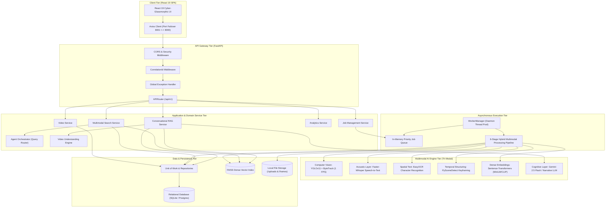
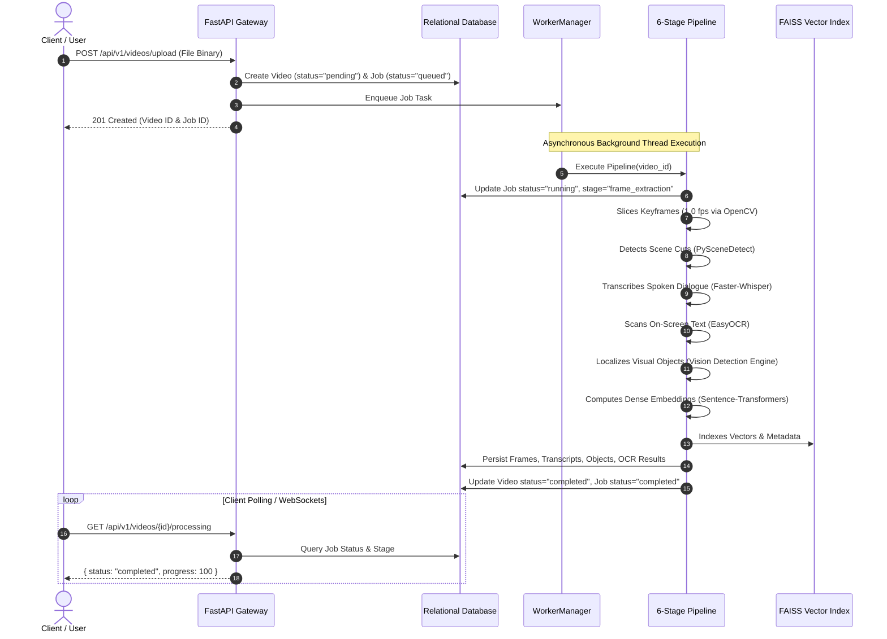

# Project Architecture

## Executive Summary
**VideoSense AI** is architected as an enterprise-grade, decoupled multimodal intelligence system following the principles of **Clean Architecture** and **Domain-Driven Design (DDD)**. The system isolates the high-responsiveness presentation client from computationally intensive computer vision, audio processing, and vector similarity workloads.

The platform solves the classic **multimodal video understanding bottleneck** through a **Hybrid Ingestion & Inference Architecture**:
1. **Intelligent Keyframe Sampling**: Rather than running heavy neural models on every raw frame (e.g., 30 FPS, which creates severe latency and compute overhead), the pipeline employs **1 FPS sampling** and **content-aware scene-cut detection (PySceneDetect)** to isolate visual transitions.
2. **Tri-Modal Sensory Synthesis**: Concurrently processes **Visual Keyframes** (YOLOv11 with temporal tracking), **Audio Dialogue** (Faster-Whisper acoustic speech-to-text), and **On-Screen Text** (EasyOCR) into unified timestamped events.
3. **Agentic Retrieval & VLM Narrative Synthesis**: Feeds multimodal signals into an **Agent Orchestrator** and **Vision-Language Model (VLM)** engine (Gemini Flash RAG) to transform raw bounding boxes into natural language scene stories, event summaries, and natural language timestamp search.
4. **Hardware VRAM Optimization**: Designed specifically to run within consumer hardware limits (<3.5GB peak VRAM on 4GB GPUs) by offloading open-vocabulary cognitive reasoning to lightweight embeddings and cloud VLM APIs while maintaining ultra-fast local vision inference.

The backend employs an asynchronous, non-blocking gateway powered by **FastAPI**, backed by a resilient background worker thread model, an extensible repository pattern with **Unit of Work**, and a dual-channel storage engine combining relational persistence with a high-speed **FAISS** vector repository.

---

## 1. Multi-Tier System Topology



---

## 2. Architectural Layers

### 2.1 Presentation Layer (Frontend SPA)
- **Role**: Delivers an immersive cyber-glassmorphic dashboard for video browsing, keyframe inspection, semantic querying, and RAG chat.
- **Key Concepts**:
  - Unidirectional state flow with React 19 hooks (`useState`, `useEffect`, `useMemo`, `useRef`).
  - Strict UI component isolation (`components/common`, `components/dashboard`, `components/timeline`, `components/search`, `components/chat`).
  - Seamless port failover client automatically testing and redirecting traffic between ports `8001` and `8000`.

### 2.2 API & Gateway Layer (`backend/app/api/`)
- **Role**: Handles HTTP lifecycle, request deserialization, payload validation, and static asset streaming.
- **Key Concepts**:
  - FastAPI routers partitioned by resource domain (`/health`, `/videos`, `/jobs`, `/search`, `/analytics`, `/chat`, `/system`).
  - Correlation ID tracking: Every request receives or carries an `X-Correlation-ID` header injected into logging contexts.
  - Standardized JSON envelope: All responses follow a unified response schema (`{ success: true, data: ..., error: null, correlation_id: ... }`).

### 2.3 Application & Business Logic Services (`backend/app/services/`)
- **Role**: Encapsulates core business rules, orchestrating database transactions, vector index queries, and job dispatches.
- **Key Modules**:
  - `VideoService`: File upload storage, metadata extraction, validation, and video stream slicing.
  - `SearchService`: Orchestrates hybrid semantic search, filtering vector matches by video ID, modality, and confidence.
  - `ChatService`: Multi-persona RAG engine compiling video transcripts, OCR text, and visual detections into LLM prompt contexts.
  - `AnalyticsService`: Aggregates temporal frequency curves, category distributions, and entity counts.

### 2.4 Data Persistence & Repository Layer (`backend/app/repositories/`)
- **Role**: Decouples application logic from the underlying database dialect and storage mechanisms.
- **Key Concepts**:
  - **Unit of Work Pattern**: Coordinates transactions across multiple entity repositories (`VideoRepository`, `JobRepository`, `FrameRepository`, `TranscriptRepository`, `ObjectRepository`) ensuring ACID compliance.
  - Asynchronous database operations using `aiosqlite` and SQLAlchemy 2.0 ORM.

### 2.5 Vector Database & Indexing Layer (`backend/app/vector_db/`)
- **Role**: Manages high-dimensional vector representations of visual keyframes and textual entities.
- **Key Concepts**:
  - **FAISS (Facebook AI Similarity Search)**: Manages fast L2 / Cosine distance indexing.
  - Persisted vector storage: Index is serialized to disk (`vector_store.index` and `metadata.json`) and synchronized upon each video ingestion.

---

## 3. Asynchronous Worker & Pipeline Execution Architecture

To prevent long-running AI inference workloads from blocking the web server event loop, VideoSense AI uses an asynchronous background worker subsystem:



---

## 4. Dual-Data Retrieval Architecture

The platform combines two complementary retrieval paradigms to provide fast, reliable search:

```text
┌────────────────────────────────────────────────────────────────────────┐
│ USER SEARCH QUERY (e.g., "red car speeding near storefront")           │
└───────────────────────────────────┬────────────────────────────────────┘
                                    │
           ┌────────────────────────┴────────────────────────┐
           ▼                                                 ▼
┌───────────────────────────────────┐    ┌───────────────────────────────────┐
│ RELATIONAL SQL QUERY (Exact Match)│    │ DENSE VECTOR RETRIEVAL (Semantic) │
│ • Filters by video_id, status     │    │ • Query embedded via MiniLM / CLIP│
│ • Exact text matches on OCR/tags  │    │ • FAISS index calculates Cosine   │
│ • Timestamp range constraints     │    │   similarity across all keyframes │
└─────────────────┬─────────────────┘    └─────────────────┬─────────────────┘
                  │                                        │
                  └─────────────────┬──────────────────────┘
                                    ▼
┌────────────────────────────────────────────────────────────────────────┐
│ HYBRID SCORE AGGREGATION & CANDIDATE RANKING                           │
│ (Weights: Vector Similarity × Detection Confidence × Keyword Match)   │
└───────────────────────────────────┬────────────────────────────────────┘
                                    ▼
┌────────────────────────────────────────────────────────────────────────┐
│ STRUCTURED RESULTS WITH TIMESTAMPED KEYFRAME THUMBNAILS & BOUNDING BOXES│
└────────────────────────────────────────────────────────────────────────┘
```

---

## 5. Client-Side Resiliency & Port Failover

To handle dual backend development environments (ports `8001` and `8000`), the client features an automated failover interceptor implemented in `frontend/src/services/api.js`:

```text
Client Request ──> http://localhost:8001/api/v1/...
                        │
                  Connection Error? (ECONNREFUSED / Network Failure)
                        │
                        ▼
               Ping http://localhost:8000/api/v1/health/
                        │
                ┌───────┴───────┐
             Success?        Failure?
                │               │
                ▼               ▼
      Switch Base URL to     Reject Promise
      http://localhost:8000  (Show Offline Status)
      and Retry Original
      Request Transparently
```

- When a request to port 8001 fails due to a network or connection drop, Axios automatically intercepts the failure before it bubbles to components.
- It tests port 8000 via `/api/v1/health/`. If alive, it updates `API_BASE_URL`, persists the choice to `localStorage`, and retries the original request.
- The user experiences zero interruption or configuration hassle.

---

## 6. Security, Middleware & Observability

- **CORS Middleware**: Configured to manage cross-origin browser requests, custom headers (`X-Correlation-ID`, `Authorization`), and HTTP methods (`GET`, `POST`, `PUT`, `DELETE`, `OPTIONS`).
- **Correlation ID Middleware**: Assigns a unique UUID to every incoming HTTP request. This ID is attached to logger records and returned in response headers for end-to-end distributed tracing.
- **Global Exception Handling**: Traps both custom domain exceptions (`BaseAppException`, `VideoNotFoundError`, `PipelineExecutionError`) and unhandled server errors, formatting them into consistent JSON error contracts with HTTP status codes and diagnostics.
