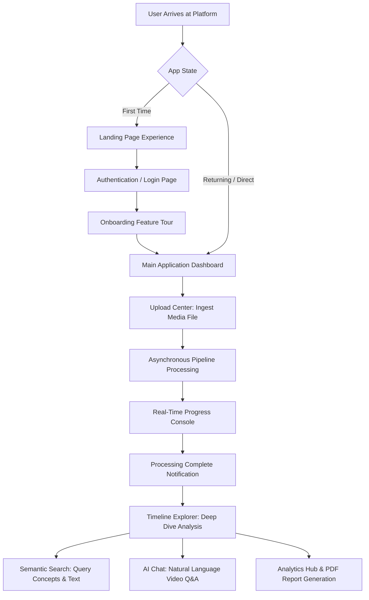

# Project Overview & User Journey

## 1. Executive Summary

**VideoSense AI** is an intelligent multimodal video understanding, search, analytics, and visual discovery platform. It transforms unstructured video repositories into rich, searchable, queryable, and actionable intelligence.

Modern organizations and content platforms capture vast volumes of video content daily. However, video data has historically remained a "black box"—opaque, difficult to search, and labor-intensive to index manually. VideoSense AI addresses this bottleneck by decomposing incoming video streams into multimodal sensory streams:
* **Audio & Speech**: High-accuracy acoustic transcription with timestamped intervals.
* **On-Screen Text (OCR)**: Spatial and temporal localization of embedded titles, license plates, signage, and documents.
* **Visual Entity Detection**: Frame-by-frame object localization, classification, tracking, and bounding box coordinate mapping.
* **Scene Segmentation**: Structural transition detection identifying scene cuts and thematic chapters.
* **High-Dimensional Embeddings**: Cross-modal vector representations enabling natural language semantic search across visual frames.

---

## 2. Core Problem Statement & Objectives

### The Problem
Traditional video asset management platforms rely on static metadata entered by human catalogers (e.g., titles, tags, descriptions). This methodology introduces major limitations:
1. **Low Granularity**: Users cannot pinpoint the exact second a specific object, phrase, or event occurred without scrubbing through the entire recording.
2. **Vocabulary Mismatch**: Traditional keyword search fails when users describe an action or visual entity using synonyms or conceptual terms not explicitly written in the metadata.
3. **No Interactive Synthesis**: Users cannot ask analytical questions (e.g., *"How many safety violations occurred in sector 3?"* or *"Summarize the incident between 02:15 and 04:30"*) and receive synthesized answers backed by visual citations.

### Strategic Objectives
* **Automated Multimodal Ingestion**: Ingest arbitrary video formats, automatically extract keyframes, transcode media, and process audio/visual channels asynchronously.
* **Zero-Latency Temporal Search**: Enable millisecond-level semantic and lexical queries that return precise video timestamp cards with keyframe previews.
* **Grounded Conversational Intelligence**: Provide an AI-powered conversational copilot that cites specific video timestamps, spatial reticles, and transcript segments for every generated claim.
* **Executive Analytics & Compliance Reporting**: Generate automated PDF audit reports, object distribution heatmaps, and timeline event graphs for security, retail, or industrial operations.
* **State-of-the-Art Visual Experience**: Provide an intuitive, responsive, cyber-glassmorphism dark interface optimized for desktop and high-density operator workstations.

---

## 3. Key Functionalities Overview

| Functional Domain | User Capabilities | Underlying Systems |
| :--- | :--- | :--- |
| **Ingestion & Processing** | Drag-and-drop video upload, real-time stage progress monitoring, automatic format validation. | Background worker pipeline, FFmpeg frame extraction, PySceneDetect. |
| **Timeline Exploration** | Synchronized video playback with active keyframe bounding box overlays, confidence filtering, and class filtering. | Interactive HTML5 video engine, dynamic SVG/CSS reticle rendering, REST sync hooks. |
| **Semantic & Lexical Search** | Query by natural language, spoken transcript words, detected object classes, or OCR text. Filter by modality and confidence. | Dual-channel retrieval engine: SQL relational filtering + FAISS dense vector search. |
| **Conversational Video Copilot** | Ask natural language questions about video context, request event summaries, and receive timestamped citation cards. | Retrieval-Augmented Generation (RAG) agent, multi-modal context aggregation. |
| **Visual Product Discovery** | Match detected apparel, electronics, and accessories in video frames against vector catalog embeddings. | Deep metric learning vector similarities, cosine similarity thresholding. |
| **Analytics & Reporting** | View object distribution charts, OCR word clouds, scene timelines, and export comprehensive branded PDF dossiers. | Recharts data visualization, ReportLab dynamic PDF generation engine. |
| **System Administration** | Monitor real-time CPU, RAM, and storage utilization, inspect background workers, and toggle active AI models. | System diagnostic APIs, Model Registry, event correlation tracking. |

---

## 4. Complete End-to-End User Journey

### Stage 1: Discovery & Entry
1. **Access**: The user navigates to the application URL (`http://localhost:5173`).
2. **Landing Page**: If accessed in marketing mode, the user experiences a high-conversion landing page presenting value propositions, key statistics, platform highlights, and an interactive product demo.
3. **Authentication**: Users authenticate via the biometric/cyber-styled login portal.
4. **Onboarding Tour**: First-time users are greeted by an interactive multi-step onboarding guide that highlights the Command Palette (`Ctrl+K`), the Timeline Explorer, and the Semantic Search Console.

### Stage 2: Media Ingestion
1. **Upload Initiation**: The user navigates to the **Upload Center** via the sidebar or clicks **Upload Video** on the dashboard.
2. **File Selection**: The user drags and drops a video file (`.mp4`, `.mov`, `.avi`, `.mkv`) into the glowing dropzone or selects from pre-loaded sample videos.
3. **Validation & Upload**: The frontend performs client-side validation (file format, size) and begins streaming the file to the backend via `axios` with an animated percentage progress ring.
4. **Pipeline Trigger**: Upon upload completion, the backend creates an asynchronous processing job and assigns a unique UUID.

### Stage 3: Real-Time Processing Monitoring
1. **Console View**: The user switches to the **AI Processing** tab to observe the live multi-stage pipeline:
   * *Stage 1*: Video metadata extraction, validation, and SHA-256 integrity hashing.
   * *Stage 2*: Intelligent scene detection and keyframe extraction.
   * *Stage 3*: Deep learning visual entity detection and coordinate bounding.
   * *Stage 4*: Optical Character Recognition (OCR) text localization.
   * *Stage 5*: Speech-to-text audio transcription with word-level timestamps.
   * *Stage 6*: Multimodal high-dimensional dense vector embedding generation.
2. **Live Feed**: Processing logs stream to the terminal-styled console with millisecond execution timestamps.

### Stage 4: Interactive Video Exploration
1. **Timeline Explorer**: Once processing completes, the user opens the video in the **Timeline Explorer**.
2. **Synchronized Playback**: The video player on the left synchronizes with the keyframe timeline strip below. Scrubbing the video updates the keyframe inspector on the right.
3. **Spatial Overlays**: Clicking any keyframe displays detected visual entities with color-coded bounding boxes, confidence badges, and coordinate dimensions.
4. **Confidence Filtering**: Users adjust the *Min Confidence* slider (e.g., from 35% to 80%) or filter by specific classes to isolate relevant entities.

### Stage 5: Semantic Retrieval & Conversational Q&A
1. **Natural Language Search**: The user enters queries in the **Semantic Search** console (e.g., *"emergency rescue operations"*, *"diamond ring on cobblestone"*, *"text signage on wall"*).
2. **Timestamp Cards**: The engine returns relevance-ranked timestamp cards. Clicking a card seeks the video player directly to that exact second and highlights the matching object or transcript line.
3. **AI Video Chat**: The user questions the video through the **AI Chat** panel (e.g., *"What safety gear are workers wearing?"* or *"Summarize what happened between seconds 20 and 40"*).
4. **Factual Citations & Verification**: The AI responds with Markdown-formatted intelligence dossiers, accompanied by clickable timestamp citations and reticle previews.

### Stage 6: Analytics & Export
1. **Executive Dossier**: The user visits the **Analytics Hub** to review detected object distributions, top keywords, scene duration breakdowns, and camera velocity metrics.
2. **Audit Export**: In the **Reports Center**, the user clicks *Export Executive PDF Report*, triggering backend ReportLab generation to produce a branded, print-ready intelligence dossier.

---

## 5. Source Code Structural References

* **Frontend Root & Navigation Router**: [App.jsx](file:///d:/VsCode/Sem%20Project/Sem%205%20Project/Proj/VideoSense%20AI/frontend/src/App.jsx)
* **Global API Communication Gateway**: [api.js](file:///d:/VsCode/Sem%20Project/Sem%205%20Project/Proj/VideoSense%20AI/frontend/src/services/api.js)
* **Backend Application Entrypoint**: [main.py](file:///d:/VsCode/Sem%20Project/Sem%205%20Project/Proj/VideoSense%20AI/backend/app/main.py)
* **Pipeline Execution Coordinator**: [pipeline.py](file:///d:/VsCode/Sem%20Project/Sem%205%20Project/Proj/VideoSense%20AI/backend/app/processing/pipeline.py)
* **Relational Database Session Factory**: [session.py](file:///d:/VsCode/Sem%20Project/Sem%205%20Project/Proj/VideoSense%20AI/backend/app/database/session.py)
